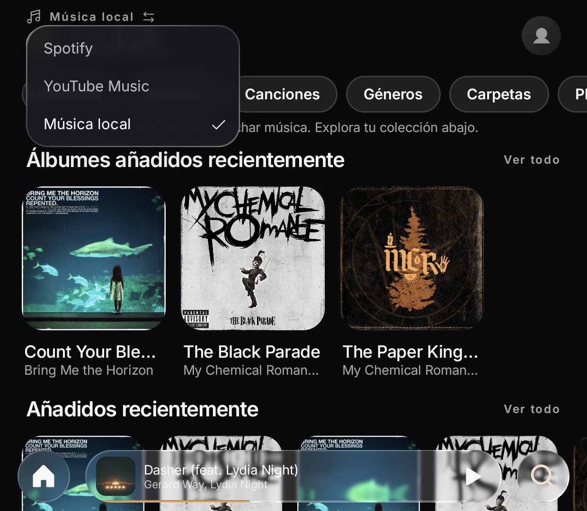
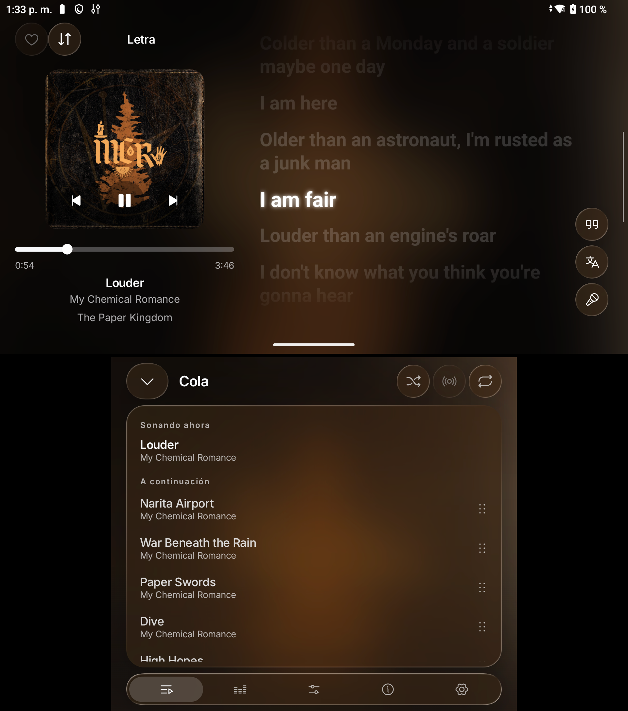
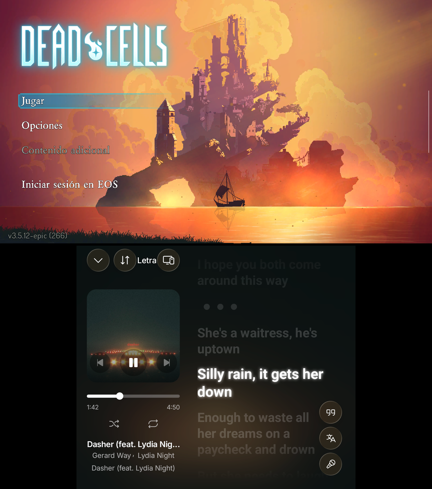
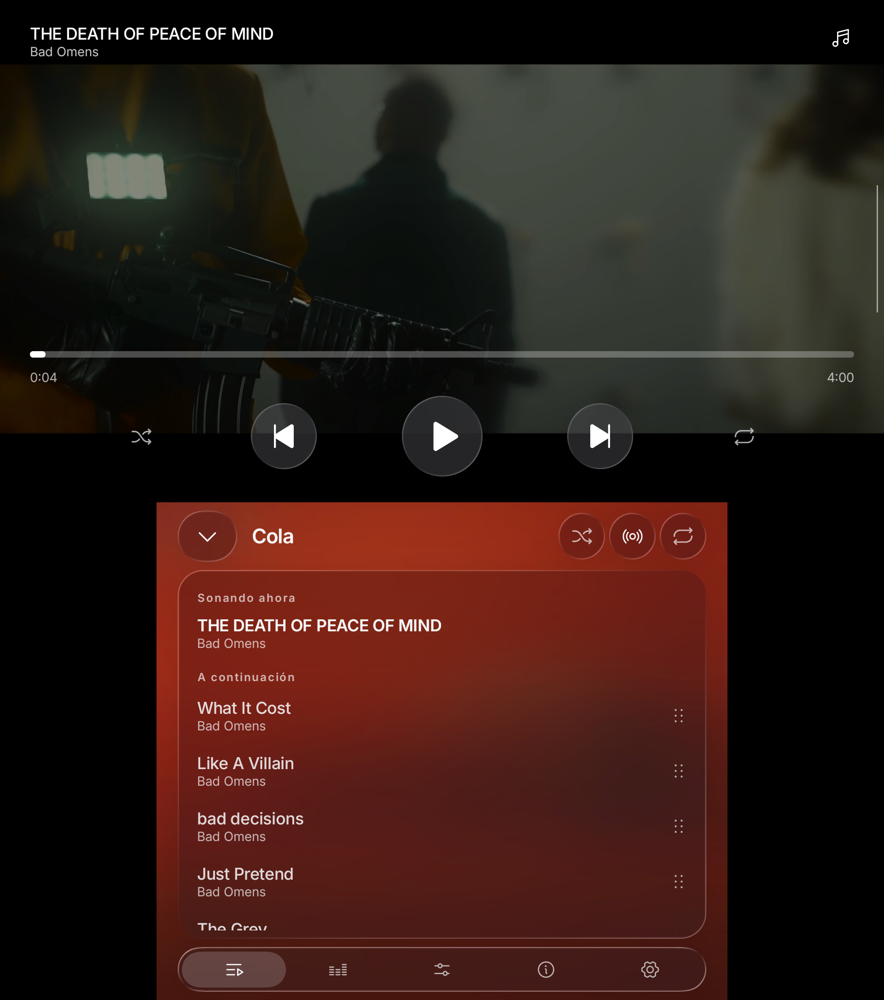
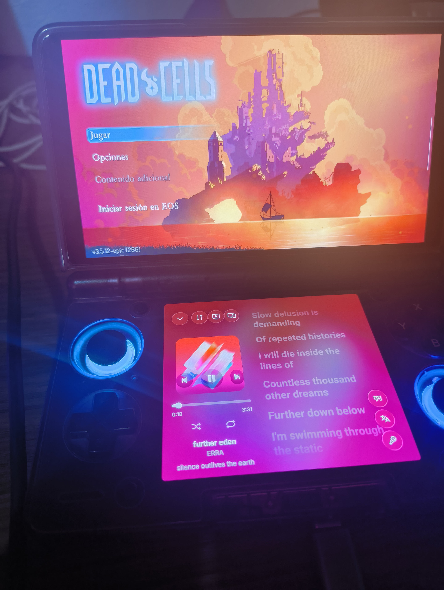
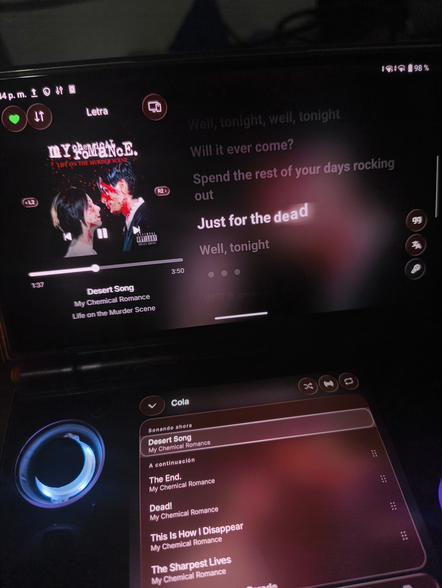
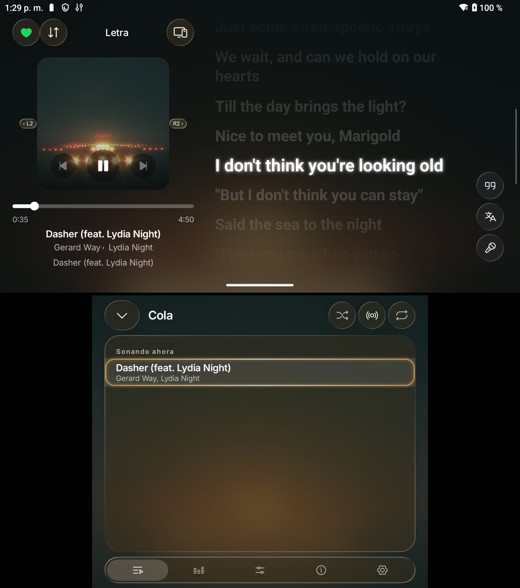

# SquareDS

**An unofficial fork of Square for dual-screen Android devices, developed and tested on the AYN Thor.**

SquareDS adapts [Square by Lelonio](https://github.com/Lelonio/Square), an unofficial Spotify Premium and YouTube Music client with a Liquid Glass interface, for dual-screen Android handhelds.

It adds dedicated dual-screen playback, an organized local music library, controller navigation, Apple Music Motion Artwork support, and the option to run the full player on the lower display.

The original Square features remain available, including Spotify Connect, synchronized lyrics, audio effects, listening history, and a Rust playback core based on librespot.

**[Download SquareDS](https://github.com/srBenjamin1/SquareDS/releases) · [Features](#features) · [Screenshots](#screenshots) · [Installation](#installation) · [Original project](#original-project)**

---

## About SquareDS

SquareDS started as an attempt to make better use of both screens on the AYN Thor.

The idea came after seeing a Spotify client developed for the Nintendo 3DS. I had been looking for a music player that could take advantage of the Thor's two displays, and eventually discovered Square.

Rather than creating a completely new music player, I decided to adapt Square's existing interface and playback functionality.

SquareDS preserves the original project's Liquid Glass design while introducing layouts and controls designed around dual-screen handhelds.

**Tested device:** AYN Thor, using its original Android firmware without root.

Other dual-screen Android devices have not yet been verified.

## Dual-screen experience

### Upper screen — Music player

The upper display is dedicated to music playback.

- Album artwork and playback controls.
- Apple Music Motion Artwork in landscape.
- Music video switching when supported.
- Synchronized lyrics and translation.
- Track information and interactive artist/album metadata.
- Playback progress and queue controls.
- Liquid Glass visual effects.

The player stays visible while browsing music on the lower screen.

### Lower screen — Navigation

The lower display provides access to:

- Home, New, Radio, Library, and Search, depending on the selected source.
- Albums, artists, songs, and playlists.
- Queue and playback controls.
- Equalizer and audio effects.
- Lyrics and song credits.
- Settings and source selection.

Navigation and playback share the same music session.

### Lower-screen-only mode

SquareDS also includes an optional mode that moves the full player interface to the lower display.

This allows the upper display to remain available for other applications, including games, depending on Android and launcher behavior.

The lower-screen player uses a landscape layout with:

- Album artwork and playback controls.
- Track information and progress.
- Shuffle and repeat.
- A separate lyrics or tools panel.
- Access to the library and navigation.

You can switch between dual-screen and lower-screen-only modes without restarting playback.

The default dual-screen presentation is restored when the application process restarts.

## Screenshots

SquareDS running on the AYN Thor.

### Dual-screen interface

| Dual-screen experience | Music player |
| :---: | :---: |
|  |  |

| Navigation | Additional interface |
| :---: | :---: |
|  |  |

### New features

| Music sources | Local music |
| :---: | :---: |
|  |  |

| Lower-screen-only mode | Motion Artwork |
| :---: | :---: |
|  |  |

### Additional screenshots

| Screenshot 1 | Screenshot 2 | Screenshot 3 |
| :---: | :---: | :---: |
|  |  |  |

### Motion Artwork demonstration

**[Watch the Apple Music Motion Artwork demo](docs/screenshots/Motion%20Artwork.mp4)**

The video demonstrates animated artwork running in SquareDS top screen.

---

## Features

### Music sources

SquareDS supports three music sources:

**Spotify Premium**

- Personal library and playlists.
- Spotify Connect.
- Music discovery and recommendations.
- Listening history.
- Supported music videos and song credits.

**YouTube Music**

- Music catalogue and search.
- Optional Google account authentication.
- Albums, artists, and playlists.
- Music videos and supported discovery features.

**Local Music**

- Offline playback of music stored on the device.
- Organized albums, artists, songs, genres, folders, and playlists.
- Local music search and listening history.
- Album artwork extracted from local files.
- Artist photographs and logos from compatible catalogue matches.
- Optional music-folder selection through Android's Storage Access Framework.
- Apple Music Motion Artwork for compatible local albums.
- Preservation of Square's original local file browser.

Without manually selected folders, the local library discovers accessible music through Android's MediaStore.

### Apple Music Motion Artwork

SquareDS supports animated album artwork in the player, including landscape mode.

For local music, the application attempts to identify the corresponding Apple Music album using album and artist metadata, with additional checks when necessary.

When a suitable animated resource is available, it can be displayed without replacing the original embedded artwork.

If no compatible resource is found, SquareDS continues displaying the static album cover.

Availability depends on the Apple Music catalogue, connectivity, and the selected artwork preferences.

### Controller navigation

SquareDS includes controller-oriented navigation for the AYN Thor.

- D-Pad and left analog stick navigation.
- Liquid Glass focus indicators.
- A to activate and B to go back.
- Shoulder-button navigation shortcuts.
- Touchscreen interaction preserved independently of controller focus.

Controller support continues to be refined and may vary depending on the current screen or feature.

### Playback and audio

- Synchronized lyrics and translation.
- Playback queue.
- Shuffle and repeat.
- Crossfade and sleep timer.
- Equalizer and audio effects.
- Playback speed and pitch.
- Reverb and audio presets.
- Karaoke vocal reduction where supported.
- Background playback.
- Spotify Connect.

Some features depend on the selected music service.

### Interface

- Liquid Glass materials.
- Dynamic colors.
- Blur, refraction, and tint effects.
- Floating navigation elements.
- Landscape layouts for dual-screen devices.
- Interactive artist and album metadata.
- Eight languages inherited from the original Square project, with additional localization work in the fork.

---

## Installation

### Requirements

- Android 8.0 or later.
- A compatible Android device.
- ARM64 APK recommended for AYN Thor.
- Spotify Premium for Spotify playback.
- Internet connection for streaming and online artwork features.

Local music playback does not require an internet connection.

### Download

Download the latest version from:

**[SquareDS — GitHub Releases](https://github.com/srBenjamin1/SquareDS/releases)**

Available APK variants may include:

- ARM64 (arm64-v8a) — recommended for AYN Thor.
- ARMv7 (armeabi-v7a).
- Universal.

Install the APK using Android's package installer.

Existing SquareDS installations can be updated without uninstalling when the package identifier, signing certificate, and Android version requirements are compatible.

### Dual-screen configuration

1. Install and open SquareDS.
2. Complete any required music-service setup.
3. Open Settings and configure Thor dual-screen mode.
4. Use the upper display for playback and the lower display for navigation.
5. Switch to lower-screen-only mode when you want the full player below.

The application does not require root or Shizuku.

---

## Development status

SquareDS is an independently maintained community fork.

The following features have been implemented and tested to varying degrees on AYN Thor:

- Dual-screen playback.
- Lower-screen navigation.
- Local music library.
- Controller navigation.
- Landscape Motion Artwork.
- Lower-screen-only player.

Compatibility with other dual-screen devices remains unverified.

Updates may take some time, as development is carried out during my available free time.

Bug reports, testing feedback, and contributions are welcome.

**[Issues](https://github.com/srBenjamin1/SquareDS/issues) · [Releases](https://github.com/srBenjamin1/SquareDS/releases)**

---

## Building from source

SquareDS uses Kotlin, Jetpack Compose, Gradle, Rust, Librespot, and the Android NDK.

The development toolchain includes Java 21, the Android SDK, Android NDK, Rust with cargo-ndk, CMake, and the Gradle Wrapper.

To build a debug APK:

```bash
./gradlew :app:assembleDebug --no-configuration-cache
```

The ARM64 debug APK is normally generated at:

```text
app/build/outputs/apk/debug/app-arm64-v8a-debug.apk
```

See [Development documentation](docs/DEVELOPMENT.md) for additional information.

---

## Original project

SquareDS is based on:

**[Square by Lelonio](https://github.com/Lelonio/Square)**

The original Square project and its contributors developed the music integrations, playback engine, Liquid Glass interface, and most of the application's underlying functionality.

SquareDS focuses on adapting that work to dual-screen Android hardware and expanding the local music experience.

This fork is independently maintained and is not an official release of Square.

## Disclaimer

SquareDS is not affiliated with, endorsed by, or connected to Spotify, Google, YouTube Music, Apple, or AYN.

It inherits unofficial service integrations from Square. These integrations may be affected by changes to third-party services or their terms of use.

Use the application at your own risk. No warranty is provided.

## Credits and acknowledgements

Special thanks to [Lelonio](https://github.com/Lelonio) and all contributors to the original Square project.

The project also relies on work from:

- [librespot](https://github.com/librespot-org/librespot) — Spotify playback engine.
- [Metrolist](https://github.com/mostafaalagamy/Metrolist) — InnerTube integration.
- [NewPipeExtractor](https://github.com/TeamNewPipe/NewPipeExtractor) — YouTube extraction.
- [Spicy Lyrics](https://github.com/Spikerko/spicy-lyrics) — Lyrics presentation.
- [AndroidLiquidGlass](https://github.com/Kyant0/AndroidLiquidGlass) — Liquid Glass materials.
- [Phosphor Icons](https://phosphoricons.com) — Iconography.
- [Bungee](https://github.com/kupix/bungee) — Time stretching.

Additional credits and licensing information are available in the original Square repository.

## License

GPL-3.0-or-later, inherited from the original Square project.

See [LICENSE](LICENSE).

The lyrics implementation derived from Spicy Lyrics retains its applicable AGPL-3.0 licensing terms.

All upstream copyright notices and third-party license requirements remain applicable.
